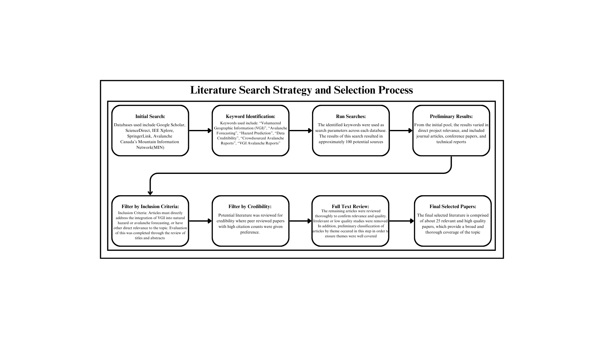
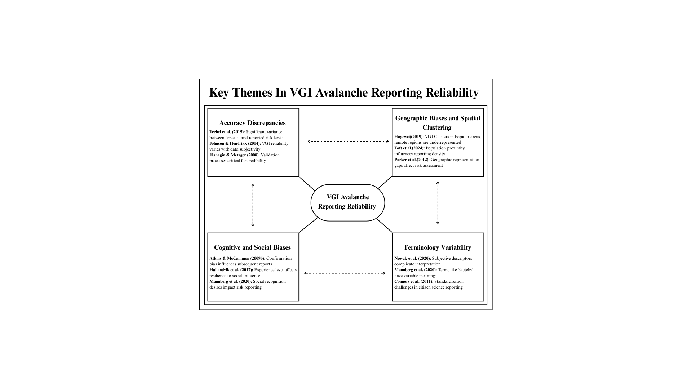
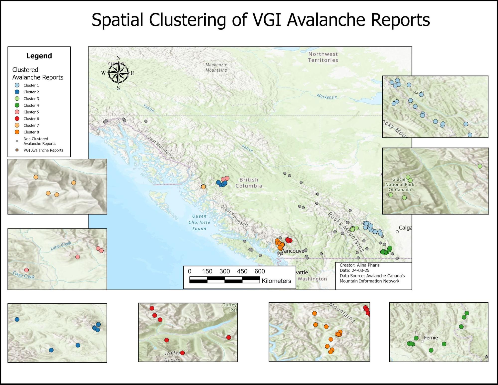
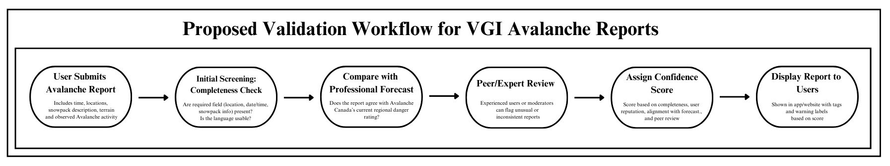

# Real-Time versus Reliable: Evaluating the Accuracy and Trustworthiness of VGI Avalanche Reporting

This research project investigates the reliability and trustworthiness of Volunteered Geographic Information (VGI) in avalanche forecasting, with a focus on geographic biases, data accuracy, subjective reporting, and the potential integration of crowdsourced observations with professional forecasts.

Through a structured literature review, thematic analysis, and spatial clustering of avalanche reports from Western Canada, the study evaluates the challenges associated with using crowdsourced geographic information for natural hazard assessment.

**Course:** GEOG 455W – Simon Fraser University  
**Date:** Spring 2025  
**Project Type:** Independent undergraduate research  
**Author:** Alina Pharis

## Research Overview

Professional avalanche forecasts provide expert assessments of avalanche conditions but often cover large geographic areas and are updated at fixed intervals. Volunteered Geographic Information, including observations submitted through Avalanche Canada's Mountain Information Network (MIN), offers more localized and timely information about snowpack conditions, weather, and avalanche activity.

However, VGI reporting introduces challenges related to data quality, uneven geographic coverage, subjective terminology, and potential reporting biases.

This project investigates two primary research questions:

1. How does the reliability of VGI compare to professionally generated avalanche forecasts?
2. What biases and limitations exist in VGI reporting that may affect backcountry users' decision-making?

The research evaluates these questions within the broader context of GIScience, particularly the challenges associated with integrating volunteered geographic data with authoritative information sources.

## Research Materials

- **[Full Research Paper](Avalanche_VGI_Research.pdf)**
- **[Interactive ArcGIS StoryMap](https://storymaps.arcgis.com/stories/ead7a03607eb43b8a6263979e5be5afe)**

The research paper documents the methodology, analysis, findings, and discussion. The StoryMap provides an additional geographic presentation associated with this coursework.

## Methodology

The study used a multi-method approach combining a structured literature review, thematic analysis, and exploratory spatial clustering.

### Literature Review

A structured literature search was conducted using academic databases including Google Scholar, ScienceDirect, IEEE Xplore, and SpringerLink.

Relevant studies were selected based on their contributions to understanding VGI reliability, data credibility, natural hazard assessment, and avalanche forecasting.

The literature was evaluated using criteria related to relevance, credibility, and methodological quality.



*Figure 1. Literature search strategy and selection process used to identify and evaluate relevant research.*

### Thematic Analysis

The literature was organized into four interconnected themes:

- **Geographic Biases and Spatial Clustering:** Uneven reporting distributions, particularly between popular backcountry locations and more remote areas.
- **Accuracy Discrepancies:** Differences between crowdsourced avalanche observations and professionally generated forecasts.
- **Cognitive and Social Biases:** The influence of personal experience, previous observations, and social factors on reporting and interpretation.
- **Subjective Risk Terminology:** Inconsistencies in descriptive language and how users interpret avalanche conditions.

These themes formed the framework for evaluating VGI reliability and its potential applications in avalanche forecasting.



*Figure 2. Thematic framework illustrating the four key themes identified through the literature review and their relationships.*

### Spatial Clustering Analysis

To investigate geographic reporting biases, a spatial clustering analysis was conducted using observations submitted to Avalanche Canada's Mountain Information Network (MIN).

The analysis examined 107 avalanche reports collected across Western Canada, including British Columbia, Alberta, and Yukon, between March 20 and March 26, 2025.

**Analysis details:**

- **Software:** ArcGIS Pro
- **Data source:** Avalanche Canada Mountain Information Network (MIN)
- **Sample size:** 107 reports
- **Study area:** Western Canada
- **Method:** Density-based spatial clustering
- **Clustering parameters:** A minimum of 4 reports within a 30 km distance threshold

Geographic coordinates were collected from MIN reports and reviewed for inconsistencies before analysis.

The clustering analysis was used to examine geographic concentrations of reporting activity and identify potential gaps in spatial coverage.



*Figure 3. Spatial clustering of 107 avalanche reports from Western Canada. Colours represent identified clusters, while unclustered observations are shown separately.*

## Results and Findings

### Geographic Clustering and Reporting Bias

The spatial analysis identified substantial clustering in the distribution of avalanche reports:

- **62.62%** of reports fell within identified spatial clusters.
- **37.38%** of reports were located outside these clusters.

The distribution was consistent with findings in the reviewed literature suggesting that VGI reporting tends to concentrate in popular backcountry areas.

This uneven distribution can create geographic information gaps, particularly in remote or less frequently travelled regions.

Although the analysis demonstrates clustering within the sample, its limited temporal scope means it cannot independently establish long-term reporting patterns.

### VGI Reliability and Data Quality

The literature review identified several factors affecting the reliability and interpretation of crowdsourced avalanche observations:

- **Geographic Representation:** Uneven reporting activity can leave some areas underrepresented.
- **Reporting Accuracy:** Differences between VGI observations and professional forecasts may result from differences in geographic specificity, timing, and data quality.
- **Cognitive and Social Influences:** Previous reports, personal experience, and social factors may influence how users describe and interpret conditions.
- **Subjective Descriptions:** Variability in terminology can make observations difficult to compare or incorporate into standardized forecasting frameworks.

Although VGI provides valuable localized information, these issues complicate its use as an independent source of avalanche hazard assessment.

### Integration with Professional Forecasting

The research concluded that VGI is most valuable as a supplementary source of information when integrated with professional avalanche forecasts.

Potential improvements identified through the study include:

- Expert validation of submitted reports
- Standardized reporting terminology and guidelines
- Confidence scoring to communicate report reliability
- Improved integration between crowdsourced observations and professional forecasting systems
- Future investigation of machine learning and AI approaches to support report validation

Based on these findings, a conceptual validation workflow was developed to explore how VGI reports could be screened, compared with professional forecasts, reviewed, and assigned confidence scores before being presented to users.



*Figure 4. Proposed workflow for evaluating the reliability of crowdsourced avalanche reports through initial screening, forecast comparison, expert review, and confidence scoring.*

This workflow represents a proposed approach rather than an implemented or experimentally validated system.

## Research Contributions

This project was independently developed as part of GEOG 455W at Simon Fraser University.

My work included:

- Developing the research questions and methodological framework
- Conducting a structured literature review
- Identifying and synthesizing themes concerning VGI reliability
- Collecting and organizing 107 avalanche reports from Avalanche Canada's MIN
- Performing density-based spatial clustering in ArcGIS Pro
- Evaluating geographic biases and limitations in crowdsourced reporting
- Developing a conceptual VGI validation workflow
- Writing a research paper discussing the implications for avalanche forecasting and GIScience

The project provided experience applying spatial analysis and critical research methods to questions of geographic data quality, environmental hazards, and the integration of volunteered and authoritative geographic information.

## Limitations

Several limitations were identified in the research:

- **Temporal Scope:** The spatial analysis examined avalanche reports submitted during a limited seven-day period.
- **Geographic Scope:** The research primarily focused on Canadian avalanche reporting and literature from North America.
- **Methodological Scope:** The study relied primarily on literature synthesis and thematic analysis rather than extensive quantitative validation.
- **Data Quality:** The subjective and inconsistent nature of VGI reports complicated comparisons with professional forecasts.
- **Changing Technologies:** VGI platforms and reporting methods continue to evolve, potentially affecting the applicability of findings from earlier research.

These limitations highlight opportunities for more extensive spatial and temporal analysis and the development of improved VGI validation methods.

## Future Research

The study identified several potential directions for further investigation:

- Expanding spatial analysis across larger geographic areas and longer time periods
- Developing more effective methods for validating crowdsourced geographic data
- Exploring machine learning approaches to identify inconsistencies and improve report reliability
- Investigating methods for integrating VGI observations with authoritative avalanche forecasts
- Improving reporting interfaces and terminology to reduce subjectivity while preserving useful local observations

## Tools and Methods

- **GIS Software:** ArcGIS Pro, ArcGIS StoryMaps
- **Spatial Analysis:** Density-based spatial clustering, geographic distribution analysis
- **Research Methods:** Structured literature review, thematic analysis, critical evaluation
- **Data Source:** Avalanche Canada Mountain Information Network (MIN)
- **Research Areas:** GIScience, volunteered geographic information, avalanche forecasting, natural hazards, spatial data quality

## Repository Structure

```text
avalanche-vgi-research/
├── README.md
├── Avalanche_VGI_Research.pdf
└── figures/
    ├── Literature_Search_Strategy.png
    ├── Proposed_validation_workflow.png
    ├── Spatial_Clustering.jpg
    └── VGI_Reporting_Reliability.png
```

## Academic Context

**Author:** Alina Pharis  
**Institution:** Simon Fraser University  
**Course:** GEOG 455W  
**Instructor:** Dr. Nadine Schuurman  
**Completed:** March 2025

This independent undergraduate research project examined the reliability of volunteered geographic information and its implications for natural hazard assessment.

The analysis is exploratory and is not intended to provide operational avalanche forecasts or replace professional avalanche safety information.

## Further Information

- [Full Research Paper](Avalanche_VGI_Research.pdf)
- [Interactive ArcGIS StoryMap](https://storymaps.arcgis.com/stories/ead7a03607eb43b8a6263979e5be5afe)
- [Avalanche Canada](https://avalanche.ca/)

